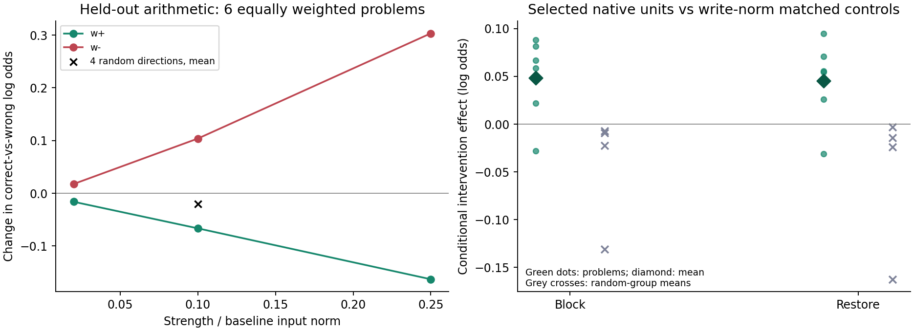
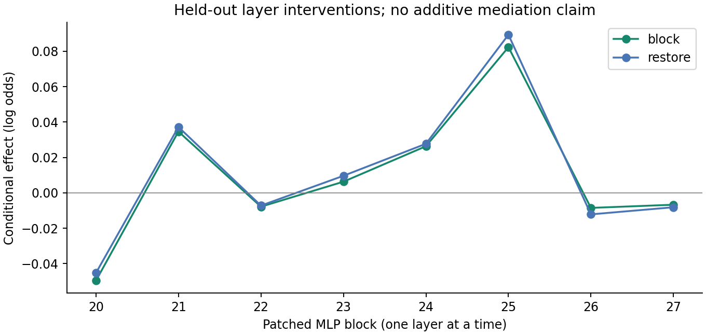

# 原生神经元干预实验结果：高响应单元可能抵消向量总效应

本轮已完成真实模型测量和完整审计。结果不支持把现有 B 向量直接称为通用“自检增强向量”：
在留出的乘法判断任务上，`+v` 平均降低正确答案相对错误答案的 log-odds；
按响应大小选出的256个原生单元，却平均抵消了其中一部分负效应。
在固定 AIME 前缀上，`+v` 增加自检措辞 marker 的概率，但候选组的迁移特异性仍未建立。

这说明需要同时解释向量的总效应、内部不同方向的作用，以及任务和措辞的条件依赖。
仅列出最受向量影响的神经元，仍不足以回答“为什么这个向量有这个功能”。

## 实际完成的范围

- Qwen3-1.7B，float32，eager attention，关闭 TF32，固定前缀重新前向，无 KV cache。
- 使用原 B 向量，在 block 20 输入的最后一个位置注入；剂量按该位置 baseline 范数定标。
- 12道乘法问题，每题交叉算式真值和自检措辞，共48个前缀。前6题只用于选单元，后6题的24个条件用于评估。
- block 20–27 每层有6144个原生 SwiGLU 单元；发现集每层选32个，共256个候选。
- 完成正负向量的三个剂量、四个随机方向、逐层和联合阻断／恢复、四组匹配随机单元对照。
- 固定 AIME 的6道问题、两种模式，共12条轨迹；原 R6 抽样规则下有18个合格位置，全部完成迁移测量。
  距每条最多两个位置的上限少6个，不补选其他位置。

所有均值先在同一问题内汇总，再对问题等权。因此算式评估和迁移评估各有6个问题，
不能把24个条件、18个位置或256个单元当作同样数量的独立问题。
本轮报告描述性效应与每题结果，不作事后显著性判定。

## 乘法任务：正方向并未提高判断表现

主读数为 `score = log P(正确答案字母集合) − log P(错误字母集合)`，单位为自然对数。
剂量的0.1表示注入量为 baseline 状态 L2 范数的0.1倍，与旧 B 路的 class_gap 剂量不同。

| 相对剂量 | +v 的平均 Δscore | −v 的平均 Δscore |
|---|---:|---:|
| 0.02 | −0.01600 | +0.01768 |
| 0.10（主剂量） | −0.06641 | +0.10387 |
| 0.25 | −0.16295 | +0.30337 |

四个随机方向在主剂量的平均效应为−0.02005。主剂量 `+v` 的每题效应范围为
−0.22918至+0.07499，存在反向案例。baseline 和 `+v` 的 argmax 判断均为16/24正确，
`−v` 为17/24；这只是同6道问题的不同条件，不能外推为总体准确率提升。

baseline 的完整 softmax 正确答案概率平均为0.66887，`+v` 为0.66236，`−v` 为0.67657。
baseline 的 A/B 答案集合覆盖率为0.999938，24个条件均未出现集合外 argmax，
因此这里的下降不是仅由忽略大量集合外输出造成的。



## 高响应候选组在这里起到补偿作用

对同一前缀，定义：

```
总效应 = score(+v) − score(base)
阻断效应 = score(+v) − score(+v 中恢复候选为 baseline)
恢复效应 = score(base 中替换候选为 +v 产品) − score(base)
```

| 联合干预 | 候选组 | 随机组0 | 随机组1 | 随机组2 | 随机组3 |
|---|---:|---:|---:|---:|---:|
| 阻断效应 | +0.04826 | −0.13117 | −0.00714 | −0.02232 | −0.00916 |
| 恢复效应 | +0.04520 | −0.16237 | −0.01444 | −0.02387 | −0.00301 |

这里阻断效应为正，意味着将候选恢复为 baseline 后，正确答案的相对分数进一步下降。
结合负的总效应，候选组更符合“在当前条件下抵消部分负效应”的描述。
恢复候选的 +v 产品也平均提高 baseline 分数，与这一条件性解释一致。
不能将这些正效应与负的总效应相除，报告成“解释了多少百分比”。

逐层结果也有相反作用：block 20 候选的阻断／恢复均值为−0.04967／−0.04533，
block 25 则为+0.08236／+0.08939。block 25 的两个效应在6个问题的条件平均上均为正。
联合效应小于部分单层效应，不能将各层当成可直接相加的独立路径。



候选选择依据是原生产品响应乘写入列范数，没有使用评估集的行为效应。
因此本结果也具体说明：响应大小排序不自动等于行为因果作用排序。
group patch 给出的是整组内部干预的条件性效应；本轮没有逐单元验证必要性或充分性。

## 措辞会改变效应方向

以下均为 `+v` 主剂量的正确相对错误答案 Δscore：

| 算式真值 | 普通措辞 | 含 “Wait, let me check.” |
|---|---:|---:|
| 正确 | +0.10610 | −0.25971 |
| 错误 | −0.13528 | +0.02324 |

正确算式要求 A，错误算式要求 B。同一答案字母的偏好移动，在这两行会得到相反符号。
本表提示应继续排查措辞调制的答案偏好，不能只把某一格变好解释为自检能力增强。
该表也未建立“措辞偏好就是全部机制”的结论，需要更换答案编码、任务与反例继续检验。

## 原生计算能解释到什么程度

单元产品为 `a = s·u`，其中 `s=SiLU(g)`。两个实际前向之间有：

```
Δa = Δs·u₀ + s₀·Δu + Δs·Δu + 产品舍入差
```

例如，block 25 的单元361是该层按发现集响应选出的最高分候选，并非按其评估行为效果选出。
在留出的 `68 × 13 = 884`、普通措辞条件中：

| 实际测量 | baseline | +v |
|---|---:|---:|
| SiLU 后 gate | 12.06509 | 11.65740 |
| value | 6.62228 | 6.04040 |
| product | 79.89845 | 70.41534 |

product 变化约−9.48310，其中 gate 项−2.69986，value 项−7.02047，交互项+0.23723，
剩余为浮点产品舍入差。这里两个因子都减小，符号分支保持 `++`；不是“gate 从关闭变为开启”。
这解释了该单元此次产品变化的直接计算原因，但未单独证明该单元的行为因果作用。
该单元在同题的错误算式和自检措辞条件中也下降，不能据此命名为正确性检测器。

`unit_atlas.json` 对全部256个候选保存了有限语料中产品最小／最大的上下文、符号分支转换、
分发现／评估／迁移集的产品展开。该图谱不是全语料语义搜索，也没有为每个神经元自动命名。
MLP 输入已包含 attention、normalization 和之前各层的影响；上述恒等式并未解释注入向量
如何沿全部上下游路径导致这些输入变化。

## AIME：措辞概率能迁移，特异线路尚未确立

沿用算式发现集的候选，未在 AIME 上重排。以下主读数是完整 softmax 后的
marker 集合 log-probability，不是答案正确性：

| 测量 | 6题等权均值 |
|---|---:|
| +v 总效应 | +0.12198 |
| −v 总效应 | −0.21718 |
| +v 的原始 marker logsumexp 变化 | +0.38812 |
| 候选联合阻断 | +0.01102 |
| 候选联合恢复 | +0.01851 |

marker 的原始 LSE 和完整 softmax logprob 均增加，但数值不同，不能混用。
候选阻断效应范围为−0.00319至+0.03218，恢复范围为−0.00268至+0.04457，
p10 的两个效应都反向。

四个匹配随机组的阻断均值依次为−0.00460、+0.00268、−0.01395、+0.01181；
恢复均值为−0.00774、+0.00032、−0.02170、+0.00986。
随机组3的阻断均值略大于候选组，因此不能声称候选在两个方向上都优于全部随机对照。
本轮支持固定位置上的条件性干预效应，尚不足以确定一个迁移特异的“自检电路”。
原向量可能与 AIME 采集来源重叠，这些位置也不能视作独立于向量提取的数据。

## 审计、运行记录和复现

冻结协议 SHA-256：
`e6bce37fa0774852e502982d69c6f3c0c462c9384dbca0d69935d3a41dcd9f1e`。
原始结果 SHA-256：
`cc32ba87e6a3b9fa3d39b2bc02a317f2dc36e3fbb17c697b8909e0aaf12aba26`。

- 48个算式格、24个留出干预格和18个迁移格全部核验；来源清单、原 R6、向量、运行代码、配置和候选统计哈希一致。
- 从各层6144个分数重放前32名选择；按固定种子重放四组随机单元及分箱匹配，均一致，匹配回退为0。
- 2,688次随机对照残差写入范数检查全部通过；最大相对误差为 `9.815e-7`，低于冻结的0.005界限。
- 最大随机控制缩放为20.379。对照幅度匹配仍不能保证自然激活分布相同，四个随机组之间也可能共享单元。
- 未挂钩／采集 baseline、零向量、两个世界的恒等 donor 替换和产品重建检查均通过。
- 35项相关测试通过；两张图已实际查看，坐标与图例可读。
- 正式测量耗时76.46秒，另有模型和数据初始化时间。zju-57 的 retry02 正常退出0，GPU已释放。
- 首次运行在首次测量前因 Transformers 5.10.4 编码返回结构不兼容而退出1；原始日志及回执位于 `attempt01/`。
  修复只显式指定整数 token ID 列表返回格式，48个真实 tokenizer 前缀预检通过后，使用独立目录重试，冻结协议未修改。

在仓库根目录、已有 NumPy／Matplotlib 环境中复核：

```sh
python3 scripts/audit_neuron_execution.py
python3 scripts/summarize_neuron_mediation.py \
  --input experiments/neuron_mediation_v1/results/native_mediation_v1.json \
  --out-dir experiments/neuron_mediation_v1/results
```

主要产物在 `experiments/neuron_mediation_v1/results/`：原始66格 JSON、候选统计 NPZ、
`summary.json`、`execution_audit.json`、`unit_atlas.json`、模型配置、退出码、原始日志与两张图。
现有 B 路 P9、LTV 判决及其他运行的门槛保持原样；本轮结果不替代它们。

## 对解释理论的具体推进

Goodfire 的[原生计算单元研究思路](https://already-clean.goodfire.com/)在这里给出了可检验的研究单位，
而非给任意向量提供一个天然唯一的语义标签。本轮把“向量影响隐藏状态”推进到了
“哪些实际 gate/value 产品改变、整组替换如何影响输出、效应如何依赖任务与措辞”。

剩下的机制缺口是：上游读入路径、正负作用的相互抵消、下游读取，以及能预测新反例的功能假说。
下一轮可在新协议下区分促进和抑制路径，并交换答案编码、加入匹配措辞但无推理任务的反例。
本轮的数据不能被当作已获得通用自检算法解释；它提供了一个必须解释补偿和情境依赖的实测案例。
