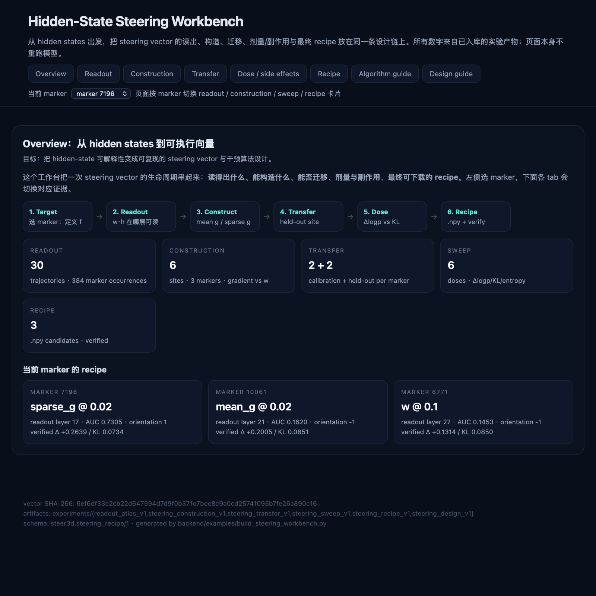

# Hidden-State Steering Workbench

> **一句话**：把 readout atlas、construction probe、held-out transfer、alpha/side-effect
> sweep、compiled recipe 和 intervention algorithm guide 串成一个**自包含 HTML**，
> 从 hidden states 出发展示「这个向量读什么、能不能构造、能不能迁移、剂量多少、
> 下一步干预算法怎么设计」。

文件：

- experiments/steering_workbench_v1/steering_workbench.html
- frontend/public/steering-workbench.html（Next public 下的副本，URL 为 /steering-workbench.html）
- 生成器：backend/examples/build_steering_workbench.py
- HTML/SVG 助手：backend/core/workbench_html.py

页面不需要 server、不需要 JS 库；直接在浏览器打开即可。所有图是预渲染 SVG，
所有数字来自已入库的 experiments/* 产物，页面本身不重跑模型。

（预览是 Quick Look 缩略图，只覆盖 Overview tab；完整交互请打开 HTML。）

## 页面结构

1. **Overview**：设计链 Target → Readout → Construct → Transfer → Dose → Recipe；
   当前 marker 的 recipe 卡片。
2. **Readout**：per-marker AUC 表、layer AUC 曲线、cos(h,w) 热图。
3. **Construction**：w / −w / g / w+g / random 的逐 site 对比、unit 四象限、
   top carriers / compensators。
4. **Transfer**：同 marker held-out 迁移表、cross-marker 热图、逐 site 读数。
5. **Dose / side effects**：有用窗口、Δlogp vs dose、log KL vs dose、逐 direction×dose 表。
6. **Recipe**：每个 marker 的 .npy 下载、expected/verified Δlogp/KL、verification sites、caveats。
7. **Algorithm guide**：把证据映射到 one-shot / per-token controller / unit-level /
   sparse 四种干预算法的选择与下一步实验。
8. **Design guide**：layer strategy、20 条推荐、warnings。

## 当前展示的核心结论

- **Readout**：set-level cos(h,w) 在 layer 21 反相关（raw AUC 0.1991）；per-marker 分裂：
  7196 正向（layer 17，AUC 0.7305），其余负向；88190/80022 n&lt;10 不可判。
- **Construction**：block-20 梯度 g 在 6/6 site 上提高目标；w 对 7196 为负。
- **Transfer**：mean g 在 held-out site 上 +0.6514 / +0.4363 / +0.1958；
  sparse 10% 保留 78-100%；7196 方向对其它 marker 为负，10061/6771 方向对其它 marker 为正。
- **Dose**：KL≤0.1 窗口：7196 sparse g@0.02（+0.2639, KL 0.0734）、10061 mean g@0.02
  （+0.2005, 0.0851）、6771 w@0.1（+0.1314, 0.0850）。mean g 效果大但 KL 大；sparse 更省；w 最安全但更弱。
- **Recipe**：3 个 marker 各一个 .npy，held-out 验证；verification 复用 transfer/sweep site，
  不是第三个独立 split。

## Algorithm guide 的落点

| 决策 | 建议 |
|---|---|
| Target | 先固定 marker vs correctness，不能混用 |
| Direction | per-marker；7196 用 sparse g，10061 用 mean g，6771 用 w |
| Layer | 注入固定 block 20；readout layer 只做诊断 |
| Dose | 按 KL 预算选，不选最大 Δlogp |
| Algorithm | 先 one-shot recipe；per-token controller 是下一实验；unit-level 需精确 grad_h a_i |
| Verification | 独立第三 split + 任务级副作用 + 第二模型后再升级 |

## 重新生成

    python3 backend/examples/build_steering_workbench.py

依赖：experiments/{readout_atlas_v1,steering_construction_v1,steering_transfer_v1,
steering_sweep_v1,steering_recipe_v1,steering_design_v1} 的 JSON。

测试：

    python3 -m pytest backend/tests/test_steering_workbench.py backend/tests/test_steering_design.py -q

## 边界

- 单模型、单层 20、短 AIME 前缀、每 marker 2 calibration + 2 held-out。
- verification 不是第三个独立 split；没有任务级正确率/生成质量。
- mean g / sparse g 是数值方向，不保证语义；高 dose 可能 off-manifold。
- 页面不重跑模型；它展示的是已入库产物的确定性和可追溯性。
